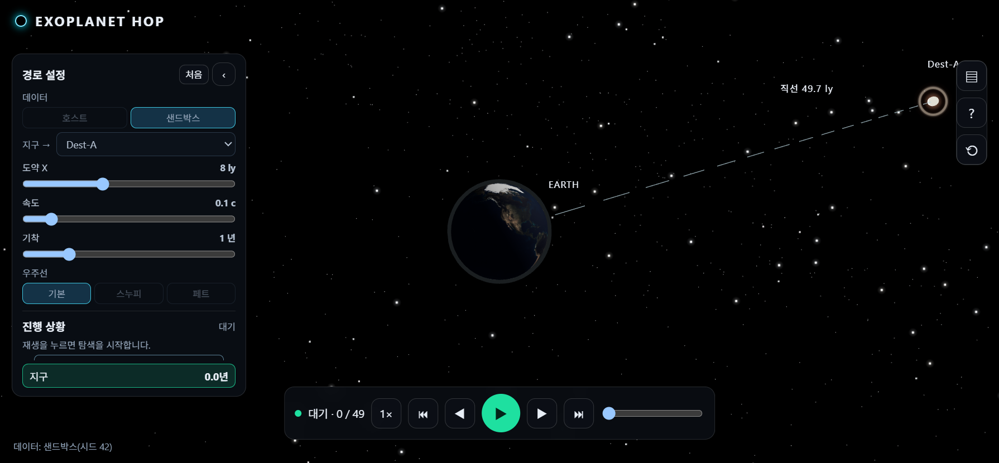
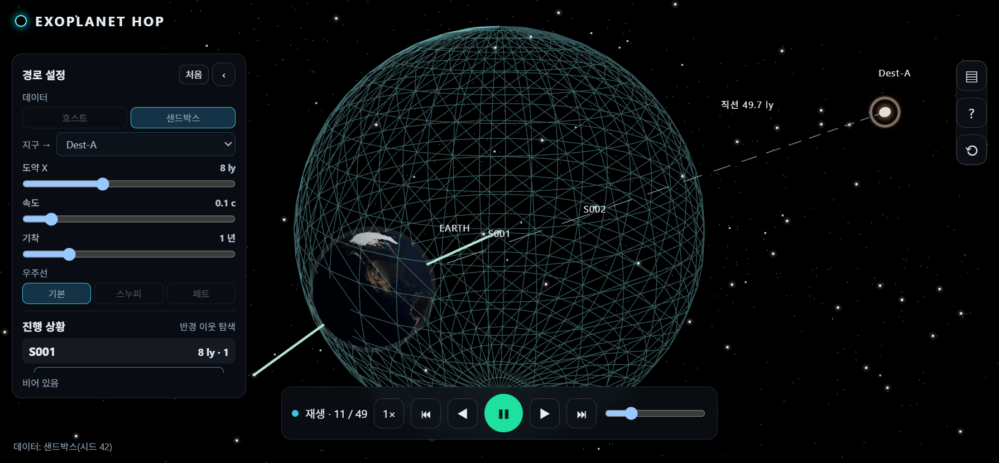

<p align="center">
  
</p>

<p align="center">
  한 번에 제한된 거리만 도약할 수 있을 때<br>
  <strong>지구에서 목적지 별까지, 총 이동 시간이 가장 짧은 경로</strong>를 찾는다.
</p>

<p align="center">
  <a href="https://exoplanet-hop-web.kim-kwanho.workers.dev"></a>
</p>

<p align="center">
  
</p>

<p align="center"><sub>기본 화면 · 합성 항성 100개 · 도약 8광년 · 목적지 Dest-A</sub></p>

확인된 외계행성 호스트 별을 3차원 좌표의 정점으로 두고, 도약 가능한 이웃만 이어 그래프를 만든다. 다익스트라는 누적 시간이 가장 짧은 별을 확정하고, k-d 트리는 그 별에서 반경 X 안의 다음 후보를 찾는다.

> 이 저장소의 시간은 설정한 그래프의 비용이다. 중력, 상대론, 별의 고유운동, 가속과 감속은 계산하지 않으며 실제 우주선 비행 시간이 아니다.

## 무엇을 푸는가

한 번에 갈 수 있는 거리는 X로 막혀 있다. 그래서 목적지까지의 직선이 곧 경로가 되지 않고, 중간 별에 들러 여러 번 도약한다. 각 도약의 시간은 거리를 속도로 나눈 값이고, 호스트 별에서 다시 떠날 때는 기착 1년이 붙는다.

| | 카탈로그 분석 | 웹 데모 기본값 |
|---|---|---|
| 정점 | 좌표가 있는 호스트 4,819개. 지구는 원점의 가상 출발점 | 시드 42로 만든 합성 항성 100개 |
| 간선 | 3차원 직선거리 ≤ 15광년 | 직선거리 ≤ 8광년 |
| 속도 | 0.1c, 곧 `0.1 ly/year` | 같음 |
| 기착 | 호스트에서 떠날 때 1년. 지구 출발과 목적지 도착에는 없음 | 같음 |
| 목적지 | 도달 가능한 별 중 지구에서 가장 먼 HD 199509 | Dest-A |

호스트 사이의 전이 비용은 양방향이 같다. 지구에서 첫 도약만 기착이 없어 비용이 다르다. 모든 비용이 0 이상이므로 다익스트라를 쓴다.

비교 기준은 별 쌍을 모두 검사해 간선 목록을 먼저 만든 뒤 같은 최단 경로를 푸는 방식이다. k-d 반경 질의가 X 안의 이웃을 빠짐없이 돌려주면 두 방식의 경로는 같다. 이 저장소는 그 실행 시간을 재어 우열을 단정하지 않는다.

## 카탈로그 경로

2026-11-05 NASA Exoplanet Archive `pscomppars`에서 `hostname`, `ra`, `dec`, `sy_dist`를 받았다. `sy_dist`는 파섹이라, 아래 IAU 정의로 광년으로 바꿔 쓴다. 6,451행을 호스트 이름으로 묶어 4,847개가 되었고, 좌표나 거리가 없는 28개를 빼 `N = 4,819`다.

X = 15광년에서 호스트 간 간선은 585개다. 지구에서 바로 닿는 별은 17개이고, 그 연결을 따라가면 132개 호스트에 도달한다. 그 가운데 지구와 직선거리가 가장 먼 별을 목적지로 골랐다. HD 199509, 약 79.274광년이다. 천문학적으로 특별한 대상이라는 뜻은 아니다.

| 호스트 | 기착 | 도약 거리 | 총 시간 |
|---|---:|---:|---:|
| 12곳 | 11회 | 149.853광년 | **1,509.533년** |

순항은 약 1,498.533년이고, 기착 11년을 더했다. 꺾인 경로가 직선보다 긴 이유는 한 도약이 15광년을 넘을 수 없기 때문이다.

<p align="center">
Earth → Ross 128 → GJ 393 → GJ 357 → GJ 367 → L 98-59 → COCONUTS-2 A<br>
→ LHS 475 → HD 222237 → LHS 3844 → GJ 3021 → nu Oct A → HD 199509
</p>

## 화면

앱은 탐색을 먼저 계산하고, 그 기록을 단계로 재생한다. 청록색 그물은 현재 별 주변의 도약 반경이고, 그 안의 별만 다음 후보가 된다.

<p align="center">
  
</p>

<p align="center"><sub>재생을 멈춘 장면 · 그물 안이 이번 도약의 후보</sub></p>

실측 호스트 300개와 목적지 HD 199509는 앱 안에서 따로 여는 프리셋이다. 그 프리셋은 위 카탈로그와 같은 비용 규칙을 따른다. 기본 샌드박스의 507.6년 같은 숫자는 합성 데이터 결과이므로 1,509.533년과 비교하지 않는다.

## 실행

Python 표준 라이브러리만 쓴다. 원본은 `data/raw/pscomppars_2026-11-05.csv`다. 저장소 루트에서 실행하면 `data/processed/`에 좌표, 15광년 간선, 경로 구간이 다시 생긴다. 이 산출물과 `report/`의 보고서·PDF는 Git에 올리지 않는다.

```bash
python scripts/analyze_catalog.py
```

웹 데모는 [web-demo](web-demo/README.md)에서 실행하고, 배포는 Vite 빌드를 Cloudflare Workers Static Assets로 올린다.

```bash
cd web-demo
npm install
npm run dev
```

## 저장소

```
exoplanet-hop/
  assets/           README 로고와 배포 화면
  notes/            수치, 가정, 복잡도 메모
  scripts/          카탈로그 분석
  data/raw/         2026-11-05 CSV
  data/processed/   분석 산출물, Git 무시
  web-demo/         3D 재생 앱
  report/           보고서와 제출 PDF, 로컬 전용
```

## 참고

- NASA Exoplanet Archive. `pscomppars`, 2026-11-05 추출. [TAP 질의](https://exoplanetarchive.ipac.caltech.edu/TAP/sync?query=SELECT%20hostname%2C%20pl_name%2C%20ra%2C%20dec%2C%20sy_dist%2C%20sy_disterr1%2C%20sy_disterr2%20FROM%20pscomppars&format=csv), [열 정의](https://exoplanetarchive.ipac.caltech.edu/docs/API_PS_columns.html).
- Dijkstra, E. W. “A Note on Two Problems in Connexion with Graphs.” *Numerische Mathematik* 1 (1959): 269–271. [DOI: 10.1007/BF01386390](https://doi.org/10.1007/BF01386390). 간선 가중치가 0 이상일 때의 최단 경로.
- Bentley, Jon Louis. “Multidimensional Binary Search Trees Used for Associative Searching.” *Communications of the ACM* 18, no. 9 (1975): 509–517. [DOI: 10.1145/361002.361007](https://doi.org/10.1145/361002.361007). k-d 트리.
- International Astronomical Union. “Resolution B2 (2012).” [PDF](https://www.iau.org/static/resolutions/IAU2012_English.pdf). 천문 단위.
- International Astronomical Union. “Resolution B2 (2015).” [PDF](https://www.iau.org/static/resolutions/IAU2015_English.pdf). 파섹은 648000/π au.
