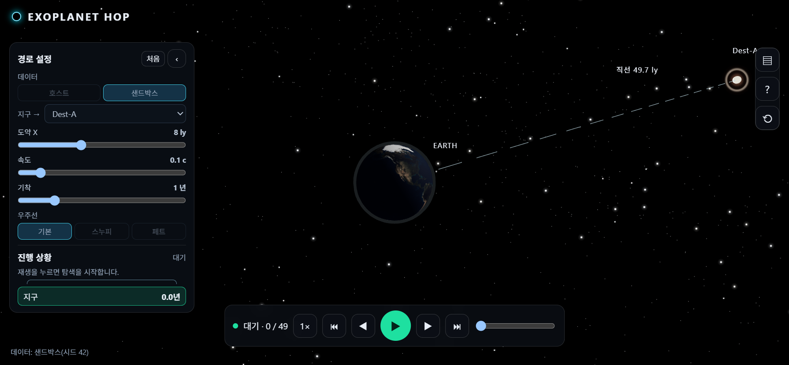

<p align="center">
  
</p>

<p align="center">
  한 번에 갈 수 있는 거리가 정해져 있을 때,<br>
  <strong>지구에서 목적지 별까지 총시간이 가장 짧은 경로</strong>를 계산하고 3D로 재생합니다.
</p>

<p align="center">
  <a href="https://exoplanet-hop-web.kim-kwanho.workers.dev"></a>
  &nbsp;
  <a href="#시작하기"></a>
  &nbsp;
  <a href="#문서"></a>
</p>

<p align="center">
  
  
  
  
</p>

<p align="center">
  
</p>

<p align="center"><sub>Live 기본 화면 · 합성 항성 100개 · 도약 8광년 · 목적지 Dest-A</sub></p>

---

Exoplanet Hop은 별 좌표 위의 최단 시간 경로를 두 트랙으로 다룹니다.

| 트랙 | 하는 일 | 들어가는 곳 |
|---|---|---|
| **Web** | 탐색을 먼저 계산하고, 확정·후보·큐를 3D에서 단계 재생 | [Live](https://exoplanet-hop-web.kim-kwanho.workers.dev) · [web-demo](web-demo/README.md) |
| **Catalog** | 2026-11-05 NASA 호스트 좌표로 15광년 그래프와 기준 경로를 재현 | `python scripts/analyze_catalog.py` |

다익스트라가 누적 시간이 가장 짧은 별을 확정하고, k-d 트리가 그 별에서 반경 X 안의 다음 후보를 찾습니다. 간선 목록은 미리 만들지 않습니다.

> 여기에 적힌 시간은 그래프 비용입니다. 중력, 상대론, 고유운동, 가속과 감속은 넣지 않으며 실제 우주선 비행 시간이 아닙니다.

## 기능

- **지연 이웃 탐색.** 별을 하나 확정할 때마다 반경 X 질의로 다음 후보만 꺼냅니다. 질의가 빠짐없으면, 모든 별 쌍을 먼저 이어 푸는 최단 경로와 같습니다.
- **단계 재생.** 계산이 끝난 기록을 처음으로 · 이전 · 재생 · 다음 · 끝으로 따라갑니다. 청록색 그물 안이 이번 도약의 후보입니다.
- **시나리오.** 샌드박스 / 호스트, 목적지, 도약 X(1–20광년), 속도(0.05c–0.5c), 기착(0–5년)을 바꾼 뒤 다시 계산합니다.
- **레이어.** 반경 구, 경로, 라벨, 격자를 켜고 끕니다. 드래그로 시점을 돌리고 `R`로 되돌립니다.
- **고정 입력.** 카탈로그 원본 CSV와 합성 시드 42를 저장소에 두어 같은 명령을 다시 돌릴 수 있습니다.

## 시작하기

웹만 보려면 Live를 열면 됩니다. 로컬에서 재생과 카탈로그를 다시 만들 때는 아래를 따릅니다.

**Web** — Node.js. 상세는 [web-demo/README.md](web-demo/README.md).

```bash
cd web-demo
npm install
npm test
npm run dev
```

**Catalog** — Python 3 표준 라이브러리만. 저장소 루트에서 실행합니다.

```bash
python scripts/analyze_catalog.py
```

`data/raw/pscomppars_2026-11-05.csv`를 읽어 `data/processed/`에 좌표, 15광년 간선, 경로 구간을 다시 씁니다. 이 산출물과 `report/`는 Git에 올리지 않습니다.

| 명령 | 하는 일 |
|---|---|
| `npm test` | 시뮬레이터 단위 테스트. 호스트 프리셋의 HD 199509 경로를 포함 |
| `npm run build` | 타입 검사 후 `dist/` 생성 |
| `npm run data` | 시드 42 합성 항성 JSON 재생성 |
| `npm run hosts` | 호스트 300개 프리셋 JSON 재생성 |
| `npx wrangler deploy` | `web-demo/`에서 Vite `dist/`를 Workers Static Assets로 배포 |

## 동작

전이 `u → v`의 비용은 년입니다. 속도 0.1c는 `0.1 ly/year`로 씁니다.

```text
cost(u, v) = distance(u, v) / 0.1 + layover(u)

layover(지구)   = 0
layover(호스트) = 1년
```

목적지에 도착하면 탐색을 끝내므로 도착 기착은 없습니다. 호스트 사이 연결은 양방향이 같고, 지구에서 첫 도약만 기착이 없습니다. 비용은 모두 0 이상입니다.


좌표는 `ra`, `dec`, `sy_dist`입니다. `sy_dist`는 파섹이라 `1 pc = 3.2615637771674333 ly`로 바꾼 뒤 직교좌표로 놓습니다. 같은 `hostname`의 좌표가 어긋나면 평균 내지 않고 멈춥니다. 이번 추출본에서는 0건입니다.

실행 시간으로 두 알고리즘의 우열을 단정하지 않습니다. 식과 15광년 규모 대입은 [notes/complexity.md](notes/complexity.md)에 있습니다. 웹의 k-d 구축은 재귀마다 정렬하므로 `Θ(N log² N)`이고, 선형 시간 선택으로 트리를 만드는 의사코드의 `Θ(N log N)`과 같은 측정이 아닙니다.

<p align="center">
  
</p>

<p align="center"><sub>재생을 멈춘 장면 · 그물 안이 이번 도약의 후보</sub></p>

## 데이터

두 데이터의 시간을 서로 비교하지 않습니다. 규칙만 공유합니다.

| | Catalog | Web 기본값 | Web 호스트 프리셋 |
|---|---|---|---|
| 정점 | 좌표가 있는 호스트 4,819. 지구는 원점의 가상 출발점 | 합성 항성 100, 시드 42 | 호스트 300 |
| 구성 | 2026-11-05 `pscomppars` 전체 | 절차적 생성 | 도달 성분 132 전체와, 그 밖에 가까운 호스트를 이름 순으로 채워 300 |
| 도약 | ≤ 15광년 | ≤ 8광년 | ≤ 15광년 |
| 속도 / 기착 | 0.1c / 호스트 출발 1년 | 같음. 화면에서 변경 가능 | 같음 |
| 목적지 | 도달 가능 별 중 지구에서 가장 먼 HD 199509 | Dest-A | HD 199509 |

6,451행을 호스트 이름으로 묶어 4,847개가 되었고, 좌표나 거리가 없는 28개를 빼 `N = 4,819`입니다. X = 15광년에서 호스트 간선은 585개, 지구에서 바로 닿는 별은 17개, 그 연결로 도달하는 호스트는 132개입니다. 성분 밖에는 이 모형에서 경로가 없습니다.

## 기준 경로

목적지 HD 199509은 지구에서 약 79.274광년입니다. 천문학적으로 특별한 대상이라는 뜻이 아니라, 도달 가능한 별 가운데 직선거리가 가장 먼 별입니다.

| 호스트 | 기착 | 도약 거리 | 총 시간 |
|---|---:|---:|---:|
| 12곳 | 11회 | 149.853광년 | **1,509.533년** |

순항은 약 1,498.533년이고 기착 11년을 더했습니다. 경로가 직선보다 긴 이유는 한 도약이 15광년을 넘을 수 없기 때문입니다.

```text
Earth → Ross 128 → GJ 393 → GJ 357 → GJ 367 → L 98-59 → COCONUTS-2 A
      → LHS 475 → HD 222237 → LHS 3844 → GJ 3021 → nu Oct A → HD 199509
```

샌드박스에서 보이는 시간(예: 507.6년)은 합성 데이터 결과입니다. 1,509.533년과 같은 측정이 아닙니다.

## 구성

```text
exoplanet-hop/
  assets/            로고, 배포 화면
  data/raw/          2026-11-05 CSV
  data/processed/    분석 산출물. Git 무시
  notes/             수치, 가정, 복잡도, 대응표
  scripts/           카탈로그 분석
  web-demo/          3D 재생 앱
    src/core/        다익스트라, k-d 트리, 단위
    src/data/        합성·호스트 JSON
    src/store/       시뮬레이션 상태
    src/ui/          인트로, 캔버스, 재생, 인스펙터
  report/            보고서와 PDF. 로컬 전용
```

| 영역 | 스택 |
|---|---|
| 화면 | React 18, TypeScript, React Three Fiber, drei, Three.js |
| 상태 | Zustand |
| 빌드 / 테스트 | Vite, Vitest |
| 배포 | Cloudflare Workers Static Assets (`exoplanet-hop-web`) |
| 카탈로그 | Python 3 표준 라이브러리 |
| 자료 | NASA Exoplanet Archive `pscomppars`, 2026-11-05 |

## 문서

| 문서 | 내용 |
|---|---|
| [web-demo/README.md](web-demo/README.md) | 로컬 실행, 배포, 데모에서 확정한 결정 |
| [notes/correspondence.md](notes/correspondence.md) | 현실 요소와 정점·간선·비용의 대응 |
| [notes/assumptions.md](notes/assumptions.md) | 고유운동, 오차, 기착을 뺀 이유 |
| [notes/complexity.md](notes/complexity.md) | 시간·공간 식과 15광년 규모 대입 |
| [notes/graph_15ly.md](notes/graph_15ly.md) | 연결 성분과 HD 199509 경로 |
| [notes/numbers.md](notes/numbers.md) | 출처가 있는 수치 |

## 범위

이 저장소가 계산하는 것:

- 고정된 3차원 좌표에서, 도약 거리 X 안의 이웃만 지나는 최소 누적 시간
- 그 탐색을 재생하는 클라이언트 앱
- 위 CSV로 그 경로를 다시 만드는 스크립트

계산하지 않는 것:

- 발견된 호스트 밖의 별. 행성이 여러 개여도 `hostname` 하나
- 고유운동, 은하 회전, 중력, 상대론, 가속·감속
- `sy_dist` 오차. 넣으면 15광년 경계의 간선이 달라질 수 있음
- 0.1c와 기착 1년을 실현된 추진 성능으로 읽는 해석. 둘 다 시간 계산용 가정
- X = 15광년을 성간 항행 한계의 측정값으로 읽는 해석. 이 추출본에서 지구 쪽 성분 132개를 만든 기준값

## 참고

- NASA Exoplanet Archive. `pscomppars`, 2026-11-05 추출. [TAP 질의](https://exoplanetarchive.ipac.caltech.edu/TAP/sync?query=SELECT%20hostname%2C%20pl_name%2C%20ra%2C%20dec%2C%20sy_dist%2C%20sy_disterr1%2C%20sy_disterr2%20FROM%20pscomppars&format=csv), [열 정의](https://exoplanetarchive.ipac.caltech.edu/docs/API_PS_columns.html).
- Dijkstra, E. W. “A Note on Two Problems in Connexion with Graphs.” *Numerische Mathematik* 1 (1959): 269–271. [DOI: 10.1007/BF01386390](https://doi.org/10.1007/BF01386390).
- Bentley, Jon Louis. “Multidimensional Binary Search Trees Used for Associative Searching.” *Communications of the ACM* 18, no. 9 (1975): 509–517. [DOI: 10.1145/361002.361007](https://doi.org/10.1145/361002.361007).
- International Astronomical Union. “Resolution B2 (2012).” [PDF](https://www.iau.org/static/resolutions/IAU2012_English.pdf). 천문 단위.
- International Astronomical Union. “Resolution B2 (2015).” [PDF](https://www.iau.org/static/resolutions/IAU2015_English.pdf). 파섹은 648000/π au.
